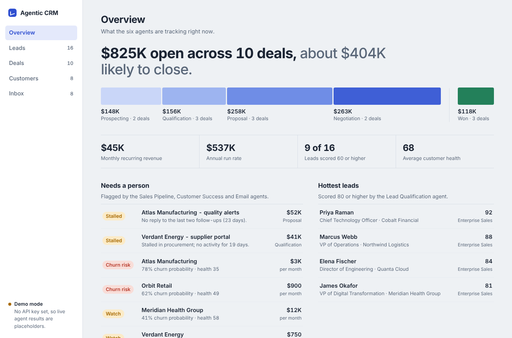
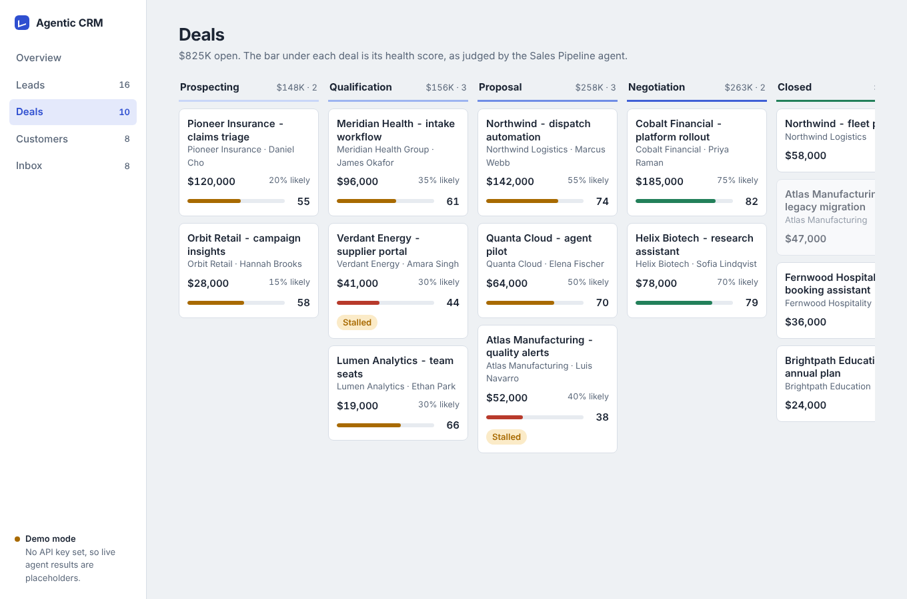
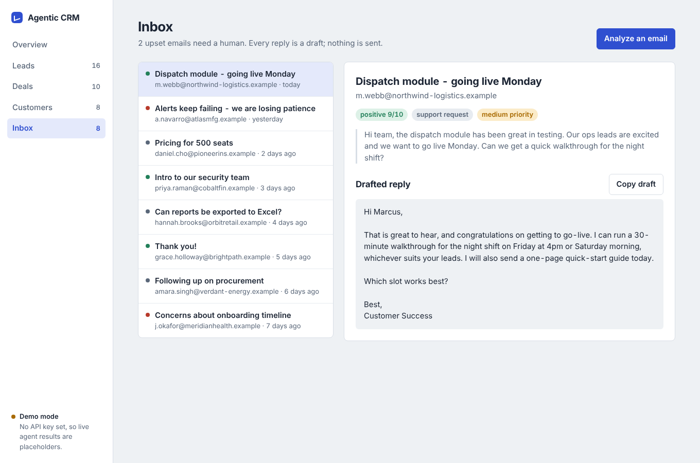

# Agentic CRM

A small CRM where AI agents do the busywork: scoring new leads, reading customer emails and drafting replies, and flagging deals and customers that need a person. It is a FastAPI backend with a built-in web dashboard, backed by PostgreSQL. The agents run on Claude.



## What it does

| Agent | What it does today |
| --- | --- |
| Lead Qualification | Scores a lead 0 to 100, finds buying signals, and routes it to Enterprise, Mid-Market, SMB or Nurture. |
| Email Intelligence | Reads an email's sentiment and emotion, files it into a category, sets a priority, and drafts a reply. Replies are drafts only; nothing is sent. |
| Sales Pipeline | Assesses deal health and flags stalled deals (API endpoint). |
| Customer Success | Tracks customer health and churn risk (API endpoint). |
| Meeting Scheduler | Suggests meeting times and prepares follow-ups (API endpoint). |
| Analytics | Builds dashboard summaries (API endpoint). |

The dashboard has five views: an overview with the open pipeline by stage and a "Needs a person" list, leads, a deals board, customers by health, and an inbox with drafted replies. Adding a lead or pasting an email in the dashboard runs the matching agent immediately and shows its result.

<p>
  
  
</p>

## Run it

You need Python 3.9 or newer and PostgreSQL 14 or newer.

```bash
git clone https://github.com/PS0601/agentic-crm.git
cd agentic-crm

python3 -m venv venv
source venv/bin/activate          # Windows: venv\Scripts\activate
pip install -r requirements-min.txt

# create the database (macOS with Homebrew shown; add -U postgres on Linux)
psql postgres -c "CREATE USER crm_user WITH ENCRYPTED PASSWORD 'crm_password';"
psql postgres -c "CREATE DATABASE ai_crm OWNER crm_user;"

cp .env.example .env
python seed_demo.py               # optional: fills the CRM with fictional demo data
python run.py
```

Open http://localhost:8000/dashboard. The raw API docs are at http://localhost:8000/docs.

`python seed_demo.py --reset` wipes all CRM tables and seeds again.

### Turn on Claude

Without an API key the app runs in demo mode: everything loads, but live agent results are placeholders (every lead scores 50, every email is neutral). The dashboard says so in the corner. To use Claude, put your key in `.env`:

```
ANTHROPIC_API_KEY=sk-ant-...
# ANTHROPIC_MODEL=claude-sonnet-5-5   (optional)
```

Restart the server. The corner badge changes to "Agents run on Claude".

## How it works

```
Browser dashboard (static/index.html)
        |
        v
FastAPI  -- api/*.py        REST endpoints for leads, deals, customers, emails
        |-- api/dashboard.py   one read endpoint + "score this lead" / "analyze this email"
        v
workflows/orchestrator.py   runs the agents and saves their results
        |
        v
agents/*.py  ----> llm.py (Claude, or a mock if no key)
        |
        v
PostgreSQL (database/models.py)
```

Each agent builds a prompt, calls the model, and parses the answer into structured fields. The Email Intelligence agent asks for JSON and falls back to loose text parsing if the model replies in prose.

## Main endpoints

| Endpoint | Purpose |
| --- | --- |
| `GET /dashboard` | The web dashboard |
| `GET /api/dashboard/summary` | Everything the dashboard shows, in one call |
| `POST /api/dashboard/leads` | Score and save a lead (runs the Lead Qualification agent) |
| `POST /api/dashboard/emails` | Analyze and save an email (runs the Email Intelligence agent) |
| `GET /api/leads`, `/api/deals`, `/api/customers`, `/api/emails` | Plain lists |
| `POST /api/agents/*` | Trigger any agent as a background task |
| `GET /health` | Health check |

## Project layout

```
agents/       the six agents and their base class
api/          FastAPI routers
database/     SQLAlchemy models and schema.sql
workflows/    orchestrator that connects agents to the database
static/       the dashboard (one HTML file, no build step)
llm.py        picks Claude or the mock
seed_demo.py  demo data
```

## Current limits

This is a working prototype, not a production system.

- No login or access control. Do not expose it to the internet as is.
- Redis, Celery, and Gmail or Calendar syncing are not implemented. The agents run as FastAPI background tasks, and emails are entered by hand.
- Only Lead Qualification and Email Intelligence are wired into the dashboard. The other agents are reachable through the API.
- Agent output depends on the model's answers. Treat scores and drafted replies as suggestions.

## Credits

Started from [KlementMultiverse/ai-crm-agents](https://github.com/KlementMultiverse/ai-crm-agents) (MIT license). The dashboard, Claude integration, demo data, and bug fixes were added on top.
